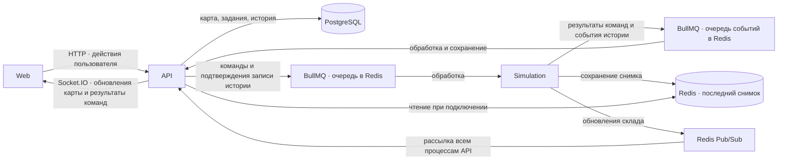

# ADR-003 — Взаимодействие Web, API и Simulation

Статус — Proposed

Дата — 2026-11-10

## Контекст

Владелец готовит карту склада и запускает доставку. Наблюдатель может открыть тот же склад через другой процесс API. Оба должны видеть одних и тех же роботов, а доставка должна продолжаться после закрытия обеих вкладок. Карту и историю заданий нужно сохранить даже после перезапуска сервера.

## Решение

Web обращается к складу через API. API проверяет права и ведёт постоянные записи в PostgreSQL. Simulation исполняет команды и определяет текущее состояние работающего склада. В первом развёртывании несколько процессов API обслуживают пользователей, а один процесс Simulation ведёт все активные склады. При обновлении Simulation прежний процесс останавливается до запуска нового. Внутри каждого склада исполнитель обрабатывает команды и шаги движения последовательно.

API и Simulation обмениваются сообщениями через две очереди BullMQ в Redis: одна несёт команды и подтверждения записи истории, другая — результаты команд и события истории. Шаги движения роботов задачами очереди не являются: текущее состояние склада сохраняется снимком в Redis и рассылается через Redis Pub/Sub.

| Модуль | Ответственность |
| --- | --- |
| Web | Редактор и диспетчерская. Передаёт действия пользователя в API, показывает подтверждённое состояние, ожидание ответа и ошибки связи. |
| warehouse-renderer | Библиотека внутри Web. Рисует карту и роботов по переданным данным, сообщает редактору о выборе клетки и перемещении объектов. |
| API | Проверяет права на HTTP-запросы Web и подписки. Владелец управляет складом, наблюдатель просматривает его. Хранит исходную карту, задания, команды, запуски и историю. Передаёт команды через BullMQ, сохраняет результаты и события из обратной очереди. Рассылает обновления своим клиентам. При отзыве доступа прекращает подписку пользователя на всех процессах API. |
| Simulation | Держит в памяти позиции, маршруты, состояния роботов и очередь исполнения. Получает команды через BullMQ, назначает задания и рассчитывает движение. Отправляет результаты и события истории в обратную очередь, сохраняет снимки в Redis и публикует обновления через Pub/Sub. Алгоритмы проверяются независимо от сети и базы данных. |
| contracts | Общая библиотека схем запросов, ответов, событий и снимков. Отправитель и получатель используют одно описание сообщения, получатель проверяет входящие данные. |

## Одна доставка от создания до завершения

1. **Подготовка.** Владелец размещает робота и две станции, сохраняет карту и создаёт задание. API проверяет права и станции, записывает карту и задание в PostgreSQL.
2. **Запуск.** После нажатия «Запустить» API одной транзакцией фиксирует версию карты, создаёт запись запуска и сохраняет команду для Simulation. Обработчик внутри API помещает команду с картой и начальной очередью заданий в BullMQ. Simulation обрабатывает команду и отправляет результат через очередь событий. API сохраняет результат и уведомляет Web. Web показывает «Запущено» после подтверждения исполнителя. До сброса карта закрыта для редактирования.
3. **Движение.** Simulation назначает робота и рассчитывает его шаги. После каждого шага она сохраняет полный снимок текущего состояния в Redis и публикует его через Pub/Sub. Каждый процесс API пересылает снимок своим подписчикам по Socket.IO. Renderer обновляет положение робота.
4. **Команды во время работы.** Новое задание API сохраняет вместе с командой передачи исполнителю. Пауза, продолжение, поломка и восстановление робота проходят тем же путём через очередь команд. Simulation определяет, допустима ли команда в текущем состоянии, и отправляет результат через очередь событий.
5. **Доставка и история.** При назначении робота, получении груза, завершении задания или ошибке Simulation отправляет событие в очередь событий. API одной транзакцией сохраняет изменение, запись истории и подтверждение, затем отправляет подтверждение через очередь команд. После подтверждения Simulation публикует соответствующее состояние.
6. **Сброс.** После подтверждения владельцем API отправляет команду сброса через BullMQ. Simulation завершает запуск и отправляет результат через очередь событий. После сохранения успешного результата API открывает сохранённую карту для редактирования, Web показывает исходные позиции. История завершённого запуска остаётся доступной.

## Гарантии обмена

- **Повтор сообщения безопасен.** Web повторяет действие с прежним идентификатором. API хранит статус и результат команды в PostgreSQL. Simulation распознаёт повтор команды в текущем запуске и повторно отправляет прежний результат. События истории и подтверждения также имеют идентификаторы: повторная обработка не создаёт новую запись и не повторяет переход состояния. BullMQ допускает повторную доставку, поэтому защита от дублей нужна в обработчиках.
- **Сохранённая команда будет отправлена.** API записывает команду или подтверждение вместе с соответствующим изменением данных в PostgreSQL. Обработчик доставляет ожидающие сообщения в BullMQ, в том числе после перезапуска API. Запись в PostgreSQL и добавление в Redis не являются общей транзакцией; при неопределённом результате отправка повторяется с прежним идентификатором.
- **Порядок сохраняется внутри склада.** Команды и события истории содержат идентификатор запуска и порядковый номер. Порядок доставки из очереди при повторах и задержках гарантированным не считаем. Ожидающие команды одного склада в каждый момент отправляет один обработчик API. Получатель применяет только сообщение с ожидаемым номером: более раннее распознаёт как повтор, более позднее откладывает до получения пропущенного. Ожидание подтверждения истории приостанавливает шаги конкретного склада, но не блокирует приём подтверждений и обработку других складов.
- **Результат доступен через любой процесс API.** После сохранения результата API публикует уведомление через Redis Pub/Sub, каждый процесс API передаёт его своим подписчикам по Socket.IO. При потере уведомления Web может запросить статус команды через API из PostgreSQL. Принятие команды в очередь не означает её успешного выполнения.
- **Подключение даёт актуальную карту.** Для активного склада API сначала оформляет подписку Pub/Sub, затем читает последний полный снимок из Redis. Снимки содержат идентификатор запуска и номер версии. Из обновлений, пришедших во время чтения, клиент применяет только более свежие для этого запуска. После переподключения браузера или восстановления подписки Redis API заново читает снимок. Снимок хранится с ограниченным сроком жизни: Simulation перезаписывает и публикует его на каждом шаге и периодически для склада без движения, в том числе на паузе. API отдаёт снимок, только если его идентификатор запуска совпадает с активным запуском в PostgreSQL. Если подходящего снимка нет, API показывает ожидание актуального состояния до следующей публикации. До запуска и после сброса API отдаёт исходную карту из PostgreSQL.
- **История переживает сбои связи.** При временной недоступности API или базы событие ожидает обработки в BullMQ. Если Redis недоступен, Simulation сохраняет неотправленное событие в памяти и повторяет отправку. До подтверждения записи в PostgreSQL следующий шаг этого склада не выполняется. Подтверждение хранится в PostgreSQL до отправки, поэтому перезапуск API между записью истории и отправкой подтверждения не оставляет склад ждать навсегда. Ожидание одного склада не блокирует остальные; общий сбой Redis может задержать все склады.
- **Перезапуск Simulation прерывает активные запуски.** Каждый процесс Simulation при старте получает новый идентификатор и указывает его в результатах, событиях и снимках. Перед исполнением команд процесс отправляет служебное событие регистрации через BullMQ и ждёт подтверждения API через обратную очередь. API помечает незавершённые запуски предыдущего процесса прерванными, закрывает их ожидающие команды и запоминает новый идентификатор как текущий. Команды содержат идентификатор процесса, которому адресованы: команды для другого процесса Simulation закрывает без исполнения, а команды, пришедшие до подтверждения регистрации, откладывает. API отклоняет результаты, события и снимки процесса, который не является текущим, поэтому два одновременно работающих процесса Simulation не могут вести один склад. Сохраняются исходная карта и подтверждённая история. Владелец может начать новый запуск.

## Обоснование и последствия

Отдельный исполнитель даёт каждому складу одно текущее состояние при любом числе процессов API. BullMQ обеспечивает очереди команд и событий с повторными попытками обработки. Результат выполнения команды и подтверждение записи истории передаются отдельными сообщениями. Redis Pub/Sub доставляет частые обновления карты сразу всем подключённым процессам API, а сохранённый снимок позволяет восстановить отображение после пропуска обновлений. Для сетки 20×20 с несколькими роботами достаточно полного снимка.

Рассматривали внутренний HTTP между API и Simulation. Ответ на вызов сразу подтверждает исполнение, а последовательная отправка сохраняет порядок без нумерации на стороне получателя. Отказались, потому что Simulation потребовались бы HTTP-сервер и служебная аутентификация, обеим сторонам — адреса друг друга, а событие истории должно было бы попадать в один из нескольких процессов API через балансировщик. BullMQ и Redis уже входят в стек проекта.

Один процесс Simulation ограничивает общий объём расчётов и при перезапуске прерывает все активные склады. Ожидание записи истории может задержать движение роботов при проблемах с базой. Очереди требуют настройки повторных попыток, хранения Redis на диске и запрета вытеснения данных очередей. Исчерпание попыток обработки должно быть видно как ошибка, а не оставлять команду в бесконечном ожидании. Полная потеря данных Redis не покрывается гарантией повторной доставки очереди. Через Redis проходят команды управления складом, поэтому доступ к нему ограничивается сетью развёртывания и учётными данными. Эти ограничения принимаем для первой версии.

## Проверка решения

Владелец и наблюдатель подключаются через разные процессы API. Владелец запускает одну доставку и после потери ответа повторяет команду. Оба видят движение одного робота. Владелец закрывает вкладку, наблюдатель видит завершение доставки. При повторном входе владелец видит актуальную карту и одну запись о завершении задания.

Во время другой доставки Redis временно недоступен: движение приостанавливается, после восстановления доставка завершается с одной записью в истории. После перезапуска Simulation незавершённый запуск отмечен прерванным, наблюдатель не видит устаревшего снимка, владелец начинает новый запуск.
