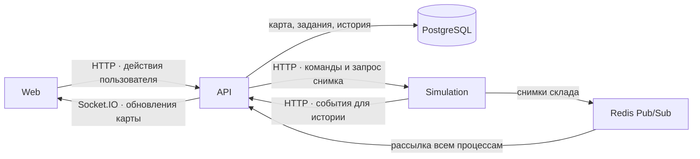

# ADR-003 — Взаимодействие Web, API и Simulation

Статус — Proposed

Дата — 2026-11-10

## Контекст

Владелец готовит карту склада и запускает доставку. Наблюдатель может открыть тот же склад через другой процесс API. Оба должны видеть одних и тех же роботов, а доставка должна продолжаться после закрытия обеих вкладок. Карту и историю заданий нужно сохранить даже после перезапуска сервера.

## Решение

Web обращается к складу через API. API проверяет права и ведёт постоянные записи в PostgreSQL. Simulation исполняет команды и определяет текущее состояние работающего склада. В первом развёртывании несколько процессов API обслуживают пользователей, а один процесс Simulation ведёт все активные склады. При обновлении Simulation прежний процесс останавливается до запуска нового. Внутри каждого склада исполнитель обрабатывает команды и шаги движения последовательно.

| Модуль | Ответственность |
| --- | --- |
| Web | Редактор и диспетчерская. Передаёт действия пользователя в API, показывает подтверждённое состояние, ожидание ответа и ошибки связи. |
| warehouse-renderer | Библиотека внутри Web. Рисует карту и роботов по переданным данным, сообщает редактору о выборе клетки и перемещении объектов. |
| API | Проверяет права на HTTP-запросы и подписки. Владелец управляет складом, наблюдатель просматривает его. Хранит исходную карту, задания, команды, запуски и историю. При отзыве доступа прекращает подписку пользователя на всех процессах API. |
| Simulation | Держит в памяти позиции, маршруты, состояния роботов и очередь исполнения. Назначает задания, рассчитывает движение и выполняет команды управления. Алгоритмы проверяются независимо от сети и базы данных. |
| contracts | Общая библиотека схем запросов, ответов, событий и снимков. Отправитель и получатель используют одно описание сообщения, получатель проверяет входящие данные. |

## Одна доставка от создания до завершения

1. **Подготовка.** Владелец размещает робота и две станции, сохраняет карту и создаёт задание. API проверяет права и станции, записывает карту и задание в PostgreSQL.
2. **Запуск.** После нажатия «Запустить» API одной транзакцией фиксирует версию карты, создаёт запись запуска и сохраняет команду для Simulation. Обработчик внутри API передаёт карту и начальную очередь по внутреннему HTTP. Web показывает «Запущено» после подтверждения исполнителя. До сброса карта закрыта для редактирования.
3. **Движение.** Simulation назначает робота и рассчитывает его шаги. Через Redis она публикует полные снимки текущего состояния. Каждый процесс API пересылает снимок своим подписчикам по Socket.IO. Renderer обновляет положение робота.
4. **Команды во время работы.** Новое задание API сохраняет вместе с командой передачи исполнителю. Пауза, продолжение, поломка и восстановление робота проходят тем же путём. Simulation определяет, допустима ли команда в текущем состоянии, и возвращает результат.
5. **Доставка и история.** При назначении робота, получении груза, завершении задания или ошибке Simulation отправляет событие в API по внутреннему HTTP. API сохраняет изменение и запись истории в одной транзакции и подтверждает событие. После подтверждения Simulation публикует соответствующее состояние.
6. **Сброс.** После подтверждения владельцем Simulation завершает запуск. API открывает сохранённую карту для редактирования, Web показывает исходные позиции. История завершённого запуска остаётся доступной.

## Гарантии обмена

- **Повтор команды безопасен.** Web повторяет действие с прежним идентификатором. API хранит результат в PostgreSQL и доставляет ожидающие команды по порядку для каждого склада, в том числе после перезапуска API. Simulation распознаёт повтор и возвращает прежний результат. События истории также имеют идентификатор, поэтому потеря HTTP-ответа и повторная отправка приводят к одной записи. Внутренние HTTP-вызовы проходят служебную аутентификацию.
- **Подключение даёт актуальную карту.** Для активного склада API оформляет подписку и запрашивает у Simulation полный снимок. Снимки содержат идентификатор запуска и номер версии. Из обновлений, пришедших во время запроса, клиент применяет только более свежие для этого запуска. После переподключения браузера или восстановления подписки Redis API заново получает снимок. До запуска и после сброса API отдаёт исходную карту из PostgreSQL.
- **История переживает сбои связи.** Если API или база временно недоступны, Simulation сохраняет событие в памяти, повторяет отправку и ждёт подтверждения перед следующим шагом этого склада. Остальные склады обрабатываются независимо.
- **Перезапуск Simulation прерывает активные запуски.** Перед приёмом команд новый процесс регистрируется в API. API помечает незавершённые запуски предыдущего процесса прерванными, закрывает их ожидающие команды и отклоняет запоздалые изменения. Сохраняются исходная карта и подтверждённая история. Владелец может начать новый запуск.

## Обоснование и последствия

Отдельный исполнитель даёт каждому складу одно текущее состояние при любом числе процессов API. HTTP позволяет подтвердить выполнение команды или запись результата. Redis Pub/Sub доставляет частые обновления карты сразу всем подключённым процессам API. Для сетки 20×20 с несколькими роботами полный снимок позволяет восстановить отображение за одно сообщение.

Один процесс Simulation ограничивает общий объём расчётов и при перезапуске прерывает все активные склады. Ожидание записи истории может задержать движение роботов при проблемах с базой. Эти ограничения принимаем для первой версии.

## Проверка решения

Владелец и наблюдатель подключаются через разные процессы API. Владелец запускает одну доставку и после потери ответа повторяет команду. Оба видят движение одного робота. Владелец закрывает вкладку, наблюдатель видит завершение доставки. При повторном входе владелец видит актуальную карту и одну запись о завершении задания.
