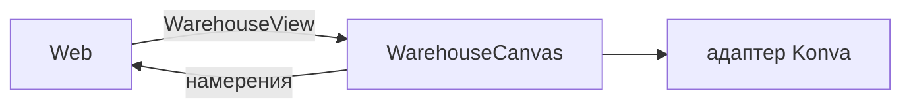

# RFC-003 — warehouse-renderer по пунктам #38

Статус — Proposed

Дата — 2026-11-20

Задача — [#38](https://github.com/warehouse-robotics-lab/warehouse-platform/issues/38)

Связное изложение тех же решений — [RFC-002](002-warehouse-renderer.md).
Этот файл раскладывает их по пунктам issue. При расхождении править оба
описания вместе.

Основания: [ADR-003](../adr/003-module-interaction.md),
[RFC-001](001-simulation-v1.md) (#28),
[ТЗ](../product-requirements.md),
[#7](https://github.com/warehouse-robotics-lab/warehouse-platform/issues/7).

Реализация пакета, сеть и полный редактор в этот документ не входят.

## 1. Состав пакета, компонент и два режима

`packages/warehouse-renderer` — React-библиотека `@warehouse/warehouse-renderer`.
Web подключает её через `workspace:*`. Публичный контракт — клетки, объекты
и намерения. Типы Konva в API пакета не входят: движок спрятан в адаптере.

Один компонент `WarehouseCanvas` обслуживает редактор и диспетчерскую.
Режим задаёт Web полем `interaction: "view" | "edit"`. Сетка, препятствия,
станции, робот и линия маршрута рисуются одним кодом. Второй холст для
просмотра не заводится.



## 2. Ответственности

| Часть | Делает | Не делает |
| --- | --- | --- |
| Web | Права, инструмент, выбранный объект, проверка клетки, изменение карты, сохранение через API, подписка на снимки и передача их в компонент | Не рисует клетки и не переводит указатель в координаты сетки |
| renderer | Камера, рисование, жест → намерение (`select`, `place`, `remove`, `move`) | Не решает, можно ли поставить объект, не вызывает API, не ищет путь |
| Simulation | Шаг, маршрут, позиция, груз, ошибка задания | Не знает о пикселях и анимации |

В режиме `view` инструменты игнорируются, наружу уходит только `select`.
В режиме `edit` пакет карту не меняет: Web принимает или отклоняет намерение
и передаёт новую `map`. Удаление приходит намерением по текущему выделению.
Клавиша и пункт меню живут в Web. Камера (сдвиг, масштаб, вписывание сетки)
остаётся внутри пакета.

## 3. Входные данные и выходные события

Координаты совпадают с RFC-001: целые `{ x, y }`, начало сверху слева,
`x` вправо, `y` вниз. Сетка первой версии — 20×20.

Модель данных прототипа Konva в продукт не переносится. Не входят зарядные
станции, различие стены и блока, прямоугольник `{ x, y, w, h }` как формат
хранения, локальные `canPlace*` и имена `Roomba N`. Препятствие — одна клетка.
Стена и блок из прототипа — один и тот же элемент. Если пользователь выделяет
прямоугольник больше 1×1, он сразу заменяется набором клеток 1×1. В симуляцию
уходит этот набор клеток, без ширины и высоты. Стеллаж с собственным id
в первую версию не входит.

Станции не имеют роли в данных карты. Отправление и назначение различаются
полями задания `pickupStationId` и `deliveryStationId`.

```ts
type Cell = { x: number; y: number }

type EditorMap = {
  mapId: string
  mapVersion: number
  gridWidth: number
  gridHeight: number
  obstacles: Cell[]
  stations: Array<{ id: string; x: number; y: number }>
  robots: Array<{ id: string; name: string; x: number; y: number }>
}

type RunView = {
  warehouseId: string
  runId: string
  snapshotVersion: number
  mapVersion: number
  tick: number
  status: "running" | "paused"
  robot: {
    id: string
    position: Cell
    status: "idle" | "busy" | "waiting"
    carryingTaskId: string | null
  }
  task: {
    id: string
    pickupStationId: string
    deliveryStationId: string
    assignedRobotId: string | null
    status: "queued" | "in_progress" | "completed" | "failed"
    phase: string
    error: { code: string; message: string } | null
  }
  route: Cell[]
}

type WarehouseView = {
  map: EditorMap
  run: RunView | null
  interaction: "view" | "edit"
  tool: EditorTool
  selection: Selection | null
}

type EditorTool = "select" | "obstacle" | "station" | "robot"

type Selection =
  | { type: "cell"; x: number; y: number }
  | { type: "obstacle"; x: number; y: number }
  | { type: "station"; id: string }
  | { type: "robot"; id: string }

type RendererIntent =
  | { type: "select"; selection: Selection | null }
  | { type: "place"; tool: "obstacle"; cells: Cell[] }
  | { type: "place"; tool: "station" | "robot"; x: number; y: number }
  | { type: "remove"; selection: Exclude<Selection, { type: "cell" }> }
  | { type: "move"; selection: Exclude<Selection, { type: "cell" }>; x: number; y: number }
```

`WarehouseCanvas` принимает `WarehouseView` и `onIntent(intent)`.

`route` — следующие клетки, включая цель, без текущей позиции (RFC-001).
На старте массив пуст. После назначения это путь до станции получения;
каждый шаг снимает первую клетку. После забора груза массив заменяется
путём до станции назначения. На паузе маршрут сохраняется. При ошибке
и после завершения он снова пуст. Для одного робота этого массива достаточно.
Когда роботов станет несколько, #36 стоит заменить его на
`{ robotId: string; cells: Cell[] }[]`: RFC-001 эту привязку не фиксирует.

Поля снимка, которые компонент не рисует, Web может не передавать:
идентификатор процесса Simulation и идентификатор карты.
`snapshotVersion` — версия снимка из RFC-001.

Сверка с RFC-001 и Web ещё впереди (Руслан, Кирилл, сторона Web/API).
Для UI в #36 предлагается явный `task.error` с `code` и `message`.
Имя робота и подписи станций Web берёт из сохранённой карты по id.

## 4. Позиция, анимация и будущий путь

Логическую клетку считает Simulation. Снимки применяет Web по ADR-003
и передаёт в компонент уже отобранное состояние. Renderer не подписывается
на сокет и не сравнивает версии с сервером сам.

Робота везёт визуальная анимация между двумя подтверждёнными клетками
одного `runId`. Длительность отрезка — разница времени прихода соседних
снимков в браузере. Интервал шага RFC-001 (500 мс) пакет не читает.
Скорости у робота в симуляции нет.

| Событие | Робот | Линия `route` |
| --- | --- | --- |
| Соседний снимок того же `runId` | Доиграть отрезок до новой клетки | Заменить линию снимком |
| Тот же `snapshotVersion` или старее | Не двигать | Не менять |
| Другой `runId` или первый снимок | Поставить в клетку сразу | Нарисовать маршрут этого снимка |
| Скачок дальше одной клетки | Поставить в новую клетку сразу | Заменить линию, путь не достраивать |
| `status: paused` | Остановить на последней подтверждённой клетке | Оставить |
| Ожидание подтверждения истории | Остаться на прошлом снимке | Оставить линию прошлого снимка |
| `run: null` после сброса | Показать робота из `EditorMap` | Убрать |

Линия строится от `robot.position` к `route[0]` и дальше по остальным
клеткам. Пустой `route` линии не даёт: старт, фазы планирования, робот
уже на цели, `completed` и `failed`. Новый снимок заменяет линию целиком.
Пройденная клетка пропадает. После погрузки виден только путь сдачи.
Пакет путь не ищет. Прототип между редкими снимками строил собственный
L-путь; в продукте так не делаем.

## 5. Примеры, локальный #20 и контракт #36

Редактор без запуска. Клик по пустой клетке даёт выбор клетки. Клик
инструментом `station` даёт намерение поставить станцию. Пакет станцию
не добавляет.

```ts
{
  map: {
    mapId: "warehouse-1",
    mapVersion: 3,
    gridWidth: 20,
    gridHeight: 20,
    obstacles: [{ x: 2, y: 1 }, { x: 3, y: 1 }],
    stations: [
      { id: "pickup-1", x: 4, y: 1 },
      { id: "delivery-1", x: 4, y: 3 }
    ],
    robots: [{ id: "robot-1", name: "Робот 1", x: 0, y: 1 }]
  },
  run: null,
  interaction: "edit",
  tool: "select",
  selection: null
}
```

Ожидаемые намерения: `{ type: "select", selection: { type: "cell", x: 5, y: 5 } }`
и `{ type: "place", tool: "station", x: 5, y: 5 }`.

Просмотр шага: `interaction: "view"`, та же геометрия, `run.robot.position`
равен `{ x: 1, y: 1 }`, `run.route` начинается со следующей клетки.
Робот доезжает из `{ x: 0, y: 1 }`, если предыдущий снимок того же `runId`
был там. Линия идёт от `(0,1)` по `run.route`. После сброса Web передаёт
`run: null` и робота на исходной клетке. Это совпадает с ADR-003.

Для локального примера #20 достаточно `EditorMap`, сетки 20×20, препятствий,
станций, одного робота и события выбора клетки. Сеть не нужна.

#36 по-прежнему нужен для снимка, `task.error`, доставки по Socket.IO
и правил версии. Этот RFC не выбирает ts-rest или tRPC и не описывает очереди.
#36 не блокирует проектирование renderer на локальных данных.

## 6. Слои и сетка 20×20

Порядок снизу вверх общий для Konva и будущего адаптера:

1. Фон и сетка.
2. Препятствия.
3. Станции.
4. Линия будущего пути, если `run.route` не пуст.
5. Робот. При `carryingTaskId !== null` — отметка груза.
6. Рамка `selection` и превью жеста редактора.

Превью жеста не входит в `EditorMap`. Текст `task.error` рисует Web рядом
с картой.

На 20×20 отдельный кэш слоя не вводится, пока замер на этой сетке не покажет
просадку. Падение частоты кадров в прототипе было на сценах около 200×200
при движении камеры (#7). Прототип отделял статичную геометрию от узлов
роботов и двигал робота смещением узла, без пересборки сетки. Этот приём
можно повторить. Подробности жестов сверяются с принятым объёмом дизайна.
Макет сам по себе жесты не утверждает.

## Граница #19 и #20

- #19 — пакет, экспорт `WarehouseCanvas`, сетка в примере Web.
- #20 — объекты из `EditorMap` и выбор клетки на локальных данных.
- Перетаскивание, инструменты, анимация и линия маршрута — отдельные задачи
  после этой границы.
- Пока #36 не принят, имена полей снимка в пакете остаются предложением.

Проверка Русланом, Кириллом, стороной Web/API и согласование Стаса в этот
файл не входят: это критерий готовности #38.
