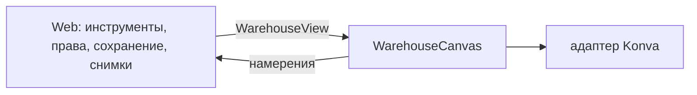

# RFC-002 — Архитектура warehouse-renderer

Статус — Proposed

Дата — 2026-11-18

Связанные задачи — [#7](https://github.com/warehouse-robotics-lab/warehouse-platform/issues/7),
[#19](https://github.com/warehouse-robotics-lab/warehouse-platform/issues/19),
[#20](https://github.com/warehouse-robotics-lab/warehouse-platform/issues/20),
[#36](https://github.com/warehouse-robotics-lab/warehouse-platform/issues/36),
[#38](https://github.com/warehouse-robotics-lab/warehouse-platform/issues/38)

Те же решения по пунктам задачи #38 — [RFC-003](003-warehouse-renderer-by-issue.md).
При расхождении править оба описания вместе.

Основания: [ADR-003](../adr/003-module-interaction.md),
[RFC-001](001-simulation-v1.md),
[ТЗ](../product-requirements.md).

Исследовательский прототип Konva лежит вне репозитория
(`warehouse-renderer`). Его модель данных в продукт не переносится.

## Контекст

Web нужен один компонент карты и для редактора, и для диспетчерской.
На созвоне 16 ноября приняты Konva и react-konva (#7). Замеры прототипа
на сценах около 200×200 показали падение частоты кадров при движении камеры.
Для сетки 20×20 этого достаточно. Смена движка не планируется, пока замеры
на целевой сетке не покажут необходимость.

Общий контракт Simulation/API ↔ Web (#36) ещё не согласован и этот RFC
не подменяет. Здесь фиксируется граница пакета и данные, которые renderer
должен уметь показать. Поля снимка, которых не хватает для отрисовки,
предлагаются как вход в #36, а не как изменение ядра.

## Решение

`packages/warehouse-renderer` — React-библиотека `@warehouse/warehouse-renderer`.
Публичный контракт описывает клетки, объекты и намерения пользователя.
Konva остаётся деталью реализации и не входит в типы, которые видит Web.

Один компонент `WarehouseCanvas` обслуживает просмотр и редактирование.
Режим задаёт Web через `interaction`. Рисование сетки, объектов и робота общее.
Инструменты, права, сохранение и подписка на снимки в пакет не входят.



Доменное движение считает Simulation. Renderer не ищет путь и не решает,
можно ли поставить объект. Он переводит указатель в клетки и сообщает
намерение. Web применяет или отклоняет его.

## Публичные данные

Координаты совпадают с RFC-001: целые `{ x, y }`, начало сверху слева,
`x` вправо, `y` вниз. Для первой версии сетка 20×20.

### Карта редактора

```ts
type Cell = { x: number; y: number }

type EditorMap = {
  mapId: string
  mapVersion: number
  gridWidth: number
  gridHeight: number
  obstacles: Cell[]
  stations: Array<{ id: string; x: number; y: number }>
  robots: Array<{ id: string; name: string; x: number; y: number }>
}
```

Препятствие — одна клетка. Стена и блок из прототипа — один и тот же элемент,
в данных они не различаются. Прямоугольника нет. Если пользователь выделяет
прямоугольник больше 1×1, он сразу заменяется набором клеток 1×1. В симуляцию
уходит этот набор клеток, без ширины и высоты. Объект «стеллаж с id и размером»
в первую версию не входит.

Станции в снимке различаются заданием (`pickupStationId`,
`deliveryStationId`), а не полем роли на самой станции. Редактор может
подписать клетку, сравнив id станции с полями задания. Отдельные роли
`pickup` / `dropoff` в данных карты не требуются.

Не переносим из прототипа:

- зарядные станции;
- различие стены и блока;
- прямоугольник препятствия `{ x, y, w, h }` как формат хранения;
- локальные правила `canPlace*` и имена роботов `Roomba N`.

### Просмотр запуска

Пока запуска нет, Web передаёт `EditorMap` и `run: null`.
Во время запуска Web передаёт ту же карту и снимок. Геометрия берётся
из карты снимка, а не из черновика редактора.

```ts
type RunView = {
  warehouseId: string
  runId: string
  snapshotVersion: number
  mapVersion: number
  tick: number
  status: "running" | "paused"
  robot: {
    id: string
    position: Cell
    status: "idle" | "busy" | "waiting"
    carryingTaskId: string | null
  }
  task: {
    id: string
    pickupStationId: string
    deliveryStationId: string
    assignedRobotId: string | null
    status: "queued" | "in_progress" | "completed" | "failed"
    phase: string
    error: { code: string; message: string } | null
  }
  route: Cell[]
}
```

`route` — следующие клетки, включая цель, без текущей позиции (RFC-001).
На старте массив пуст. После назначения в нём путь до станции получения;
каждый шаг снимает первую клетку. После забора груза массив заменяется
путём до станции назначения. На паузе маршрут сохраняется. При ошибке
и после завершения он снова пуст. Для анимации шага маршрут не нужен:
Simulation публикует полный снимок после каждого шага на соседнюю клетку.

Поля снимка из RFC-001, часть 3, которые renderer не рисует, Web может
не передавать в компонент: идентификатор процесса Simulation и идентификатор
карты. `snapshotVersion` — это «версия снимка» из RFC-001. Имя явно
отделяет её от `mapVersion`.

### Что предлагается уточнить в контракте #36

Снимок RFC-001 для отрисовки почти достаточен. Для компонента не хватает
явной формы ошибки задания: renderer показывает `failed` и текст причины,
поэтому в `task.error` нужны стабильные `code` и `message`. Сейчас RFC-001
описывает ошибку полями вроде `NO_PATH` и этапа, но не как объект для UI.

Имя робота и подписи станций в снимке запуска не обязательны: Web может
взять их из сохранённой карты по id. Если API не отдаёт их рядом со
снимком, их стоит добавить в контракт #36, не в ядро движения.

Для одного робота `route: Cell[]` достаточен. RFC-001 не фиксирует,
чей маршрут в снимке, когда роботов несколько. В #36 массив тогда стоит
заменить на `{ robotId: string; cells: Cell[] }[]`. На первую версию
это не блокер.

## Компонент

```ts
type WarehouseView = {
  map: EditorMap
  run: RunView | null
  interaction: "view" | "edit"
  tool: EditorTool
  selection: Selection | null
}

type EditorTool = "select" | "obstacle" | "station" | "robot"

type Selection =
  | { type: "cell"; x: number; y: number }
  | { type: "obstacle"; x: number; y: number }
  | { type: "station"; id: string }
  | { type: "robot"; id: string }

type RendererIntent =
  | { type: "select"; selection: Selection | null }
  | { type: "place"; tool: "obstacle"; cells: Cell[] }
  | { type: "place"; tool: "station" | "robot"; x: number; y: number }
  | { type: "remove"; selection: Exclude<Selection, { type: "cell" }> }
  | { type: "move"; selection: Exclude<Selection, { type: "cell" }>; x: number; y: number }
```

`WarehouseCanvas` принимает `WarehouseView` и `onIntent(intent)`.
В режиме `view` инструменты игнорируются, наружу уходит только `select`.
В режиме `edit` жест становится намерением, карта в пакете не меняется.
Web проверяет клетку, права и пересечения, затем передаёт новую `map`.

Удаление — намерение по текущему выделению. Клавиша и пункт меню живут в Web.
Renderer не вызывает API.

Камера (сдвиг, масштаб, вписывание сетки) остаётся внутри пакета.
На 20×20 отдельный слой кэша не вводится, пока замер на этой сетке
не покажет просадку. Прототип уже отделял статичную геометрию от узлов
роботов и двигал робота смещением узла, без пересборки сетки.

## Анимация

Логическая позиция — клетка последнего применённого снимка.
Между снимками одного `runId` робот визуально едет из предыдущей клетки
в новую за интервал шага. Предложенный интервал RFC-001 — 500 мс.
Пакет не читает таймер Simulation: длительность сегмента — разница
времени прихода соседних снимков в браузере.

| Событие | Поведение |
| --- | --- |
| Соседний снимок того же `runId` | Доиграть отрезок до новой клетки |
| Тот же `snapshotVersion` или старее | Не двигать и не перезапускать анимацию |
| Другой `runId` или первый снимок | Поставить робота в клетку сразу |
| Скачок дальше одной клетки | Поставить в новую клетку сразу, путь не достраивать |
| `status: paused` | Остановить анимацию на последней подтверждённой клетке |
| `run: null` после сброса | Показать робота из `EditorMap`, без хвоста маршрута |

Прототип между редкими снимками строил собственный L-путь. Это давало
неверный угол и обход препятствий. В продукте так не делаем: пропущенный
шаг заменяется следующим полным снимком (ADR-003), а не локальным поиском.

Пока шаг с событием истории ждёт подтверждения, клиент остаётся
на прошлом снимке (RFC-001). Анимация не едет в кандидата.

## Линия будущего пути

Линия строится от `robot.position` к `route[0]` и дальше по остальным
клеткам. Пустой `route` означает, что линии нет: старт, фазы планирования,
робот уже на цели, `completed` и `failed`. Новый снимок заменяет линию
целиком. Пройденная клетка с неё пропадает. После погрузки виден только
путь сдачи. На паузе линия остаётся. До подтверждения истории остаётся
линия прошлого снимка. После сброса (`run: null`) линии нет. Пакет путь
не ищет и не достраивает.

## Слои отрисовки

Порядок снизу вверх, общий для Konva и будущего адаптера:

1. Фон и сетка.
2. Препятствия.
3. Станции.
4. Линия будущего пути, если `run.route` не пуст.
5. Робот. При `carryingTaskId !== null` — отметка груза.
6. Рамка `selection` и превью жеста редактора.

Превью жеста не входит в `EditorMap`. Ошибка задания рисуется Web рядом
с картой по `task.error`, не внутри холста.

## Примеры

Редактор, запуска нет:

```ts
{
  map: {
    mapId: "warehouse-1",
    mapVersion: 3,
    gridWidth: 20,
    gridHeight: 20,
    obstacles: [{ x: 2, y: 1 }, { x: 3, y: 1 }],
    stations: [
      { id: "pickup-1", x: 4, y: 1 },
      { id: "delivery-1", x: 4, y: 3 }
    ],
    robots: [{ id: "robot-1", name: "Робот 1", x: 0, y: 1 }]
  },
  run: null,
  interaction: "edit",
  tool: "select",
  selection: null
}
```

Клик по пустой клетке в этом режиме даёт
`{ type: "select", selection: { type: "cell", x: 5, y: 5 } }`.
Клик инструментом `station` даёт
`{ type: "place", tool: "station", x: 5, y: 5 }`.
Пакет не добавляет станцию сам.

Просмотр шага доставки: `interaction: "view"`, `map` — геометрия выше,
`run.robot.position` равен `{ x: 1, y: 1 }`, `run.route` начинается
со следующей клетки. Робот доезжает из `{ x: 0, y: 1 }`, если предыдущий
снимок того же `runId` был там. Линия идёт от `(0,1)` через клетки
`run.route`. Пустой `run.route` линии не даёт.

После сброса Web передаёт `run: null` и робота на исходной клетке карты.
Это совпадает с ADR-003: после сброса клиент видит сохранённую карту.

## Что уже проверено локально и что ждёт #36

Локальный прототип #7 / будущий пример #20 может использовать `EditorMap`,
`Selection` и `RendererIntent` без сети. Для #20 достаточно сетки,
препятствий, станций, одного робота и события выбора клетки.

Общий контракт #36 по-прежнему нужен, чтобы зафиксировать снимок,
`task.error`, доставку по Socket.IO и правила версии. Этот RFC не выбирает
ts-rest или tRPC и не описывает очереди.

## Последствия

- Реализация #19 ограничивается пакетом, сеткой и экспортом компонента.
- #20 показывает объекты из `EditorMap` и отдаёт выбор клетки.
- Перетаскивание, инструменты и анимация входят в пакет после отдельных задач.
- Замена Konva на другой движок меняет адаптер, а не props Web.
- Пока #36 не принят, имена полей снимка в пакете считаются предложением.
